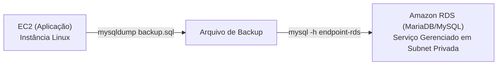

# Lab AWS - Migracao de Banco de Dados EC2 para Amazon RDS (MariaDB)

Prática realizada durante a formação **AWS re/Start (Escola da Nuvem)** demonstrando a migração de um banco de dados relacional que rodava dentro de um servidor virtual (EC2 com MariaDB) para o serviço gerenciado de banco de dados **Amazon RDS**.

A maior parte do processo foi realizada pelo **Console da AWS**, utilizando o terminal Linux apenas para os comandos essenciais de exportação (`mysqldump`) e importação (`mysql`).

---

## 🏛️ Cenário e Vantagens da Migração

* **Antes (Banco on-instance):** O banco de dados roda dentro da mesma EC2 da aplicação. Se o servidor cair, o banco cai junto. Backups manuais, sem replicação e gerenciamento manual de discos.
* **Depois (Amazon RDS Gerenciado):** Desacoplamento da aplicação e do banco. A AWS cuida dos backups automáticos, patches de segurança do sistema operacional, replicação e alta disponibilidade.



---

## 🛠️ Passo a Passo da Migração

### 1. Criar o Banco no Amazon RDS (Console RDS)
1. Acesse o **Amazon RDS** no console e clique em **Criar banco de dados**.
2. Método de criação: **Criação padrão**.
3. Mecanismo: **MariaDB** (ou **MySQL**).
4. Modelo: **Nível gratuito** (Free Tier).
5. Configurações:
   - Identificador da instância: `meu-banco-rds`.
   - Nome do usuário principal: `admin`.
   - Senha principal: criar e anotar uma senha segura.
6. Tipo de instância: `db.t3.micro` ou `db.t4g.micro`.
7. Conectividade (Rede):
   - Conectar ao recurso de computação EC2: selecionar a instância da aplicação, ou criar um Security Group liberando a porta `3306` apenas para a EC2.
8. Clique em **Criar banco de dados** e aguarde o status mudar para *Disponível*.
9. Copie o **Endpoint** gerado (ex: `meu-banco-rds.c123456789.us-east-1.rds.amazonaws.com`).

---

### 2. Exportar o Banco de Dados Local na EC2 (Terminal Bash)
Acesse a instância EC2 via terminal e execute o backup do banco de dados local com `mysqldump`:

```bash
# Exporta o banco de dados local para um arquivo SQL
mysqldump -u root -p meubanco > meubanco_backup.sql
```

---

### 3. Importar os Dados para o Amazon RDS (Terminal Bash)
Com o endpoint do RDS em mãos, conecte e restaure os dados diretamente no RDS a partir da EC2:

```bash
# 1. Cria o banco vazio no RDS
mysql -h <ENDPOINT_DO_RDS> -u admin -p -e "CREATE DATABASE meubanco;"

# 2. Importa o arquivo de backup para dentro do Amazon RDS
mysql -h <ENDPOINT_DO_RDS> -u admin -p meubanco < meubanco_backup.sql
```

---

### 4. Armazenar Credenciais com Segurança no Parameter Store (Console SSM)
Para não deixar a senha do banco em texto puro nos arquivos de configuração da aplicação:
1. Vá em **AWS Systems Manager** > **Parameter Store**.
2. Clique em **Criar parâmetro**.
   - Nome: `/app/database/endpoint` -> Tipo: `String` -> Valor: o endpoint do RDS.
   - Nome: `/app/database/password` -> Tipo: `SecureString` (criptografado com AWS KMS) -> Valor: a senha do banco.
3. A aplicação agora pode ler as credenciais de forma segura através da IAM Role da instância.

---

## 🧪 Validação
Para confirmar que os dados foram migrados com sucesso:
```bash
# Conecte no RDS e liste as tabelas
mysql -h <ENDPOINT_DO_RDS> -u admin -p meubanco -e "SHOW TABLES; SELECT COUNT(*) FROM usuarios;"
```

---

## 🧹 Limpeza de Recursos (Teardown)
1. No console RDS, selecione a instância `meu-banco-rds` e clique em **Ações > Excluir** (desmarcar opção de criar snapshot final se for apenas ambiente de estudo).
2. Finalizar as instâncias EC2 utilizadas.
