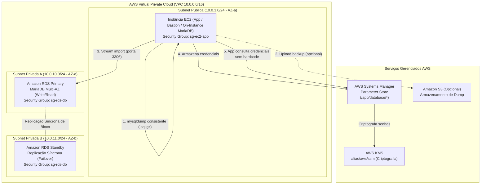

# 🚀 AWS Lab: Migração On-Instance para Amazon RDS Multi-AZ

[](https://aws.amazon.com/rds/)
[](https://mariadb.org/)
[](https://www.gnu.org/software/bash/)
[](https://aws.amazon.com/systems-manager/)
[](LICENSE)

Este repositório contém o guia prático, automações e decisões de arquitetura para migração de um banco de dados relacional legada (*on-instance* MariaDB em instância Amazon EC2) para uma infraestrutura moderna, altamente disponível e resiliente baseada no **Amazon RDS Multi-AZ** em subnets privadas, desacoplando configurações da aplicação por meio do **AWS Systems Manager Parameter Store**.

---

## 📑 Sumário

- [Visão Geral & Diagrama de Arquitetura](#-visão-geral--diagrama-de-arquitetura)
- [Topologia de Rede & Segurança](#-topologia-de-rede--segurança)
- [Estrutura do Repositório](#-estrutura-do-repositório)
- [Passo a Passo de Execução](#-passo-a-passo-de-execução)
  - [1. Carga Inicial do Schema de Testes](#1-carga-inicial-do-schema-de-testes)
  - [2. Backup Consistente e Exportação](#2-backup-consistente-e-exportação)
  - [3. Restauração e Carga no Amazon RDS](#3-restauração-e-carga-no-amazon-rds)
  - [4. Desacoplamento via SSM Parameter Store](#4-desacoplamento-via-ssm-parameter-store)
  - [5. Validação e Reconciliação](#5-validação-e-reconciliação)
- [Decisões de Arquitetura (ADR)](#-decisões-de-arquitetura-adr)
- [Estimativa de Custos (FinOps)](#-estimativa-de-custos-finops)
- [Teardown & Limpeza de Recursos](#-teardown--limpeza-de-recursos)

---

## 🏗 Visão Geral & Diagrama de Arquitetura

O objetivo central deste laboratório é eliminar pontos únicos de falha (SPOF) e sobrecarga operacional de gerenciamento de banco de dados no nível do sistema operacional (SO patches, storage management, backups manuais), migrando para um serviço totalmente gerenciado pela AWS.



---

## 🔒 Topologia de Rede & Segurança

| Componente | Configuração / CIDR | Função |
| :--- | :--- | :--- |
| **VPC** | `10.0.0.0/16` | Isolamento de rede do ambiente |
| **Subnet Pública** | `10.0.1.0/24` (AZ `us-east-1a`) | Acomoda a EC2 que processa a migração e servidor web |
| **Subnets Privadas** | `10.0.10.0/24` e `10.0.11.0/24` | RDS DB Subnet Group cobrindo no mínimo duas AZs |
| **Security Group EC2 (`sg-ec2-app`)** | Saída liberada na porta `3306` para `sg-rds-db` | Origem autorizada de tráfego de banco |
| **Security Group RDS (`sg-rds-db`)** | Entrada na porta `3306` autorizada exclusivamente via `sg-ec2-app` | Zero exposição para a internet pública (`PubliclyAccessible=No`) |

---

## 📂 Estrutura do Repositório

```text
aws-lab-rds-migration/
├── README.md                      # Documentação técnica completa
├── .gitignore                     # Ignora dumps, credenciais e logs
├── schema/
│   └── sample_database.sql        # Modelo de dados e registros de teste
├── scripts/
│   ├── dump_and_export.sh         # Backup consistente com compressão e checksum
│   └── import_to_rds.sh           # Importação no RDS com validação de rede e dados
└── config/
    └── parameter_store_setup.sh   # Cadastro de segredos e endpoints no SSM Parameter Store
```

---

## 🚀 Passo a Passo de Execução

### 1. Carga Inicial do Schema de Testes

Na instância EC2 onde o banco de dados de origem (MariaDB/MySQL) está em execução, carregue o schema de exemplo:

```bash
mysql -u root -p < schema/sample_database.sql
```

Verifique se a base foi criada e populada:

```bash
mysql -u root -p -e "SELECT count(*) AS total_clientes FROM ecommerce_db.customers;"
```

---

### 2. Backup Consistente e Exportação

Execute o script `scripts/dump_and_export.sh` para extrair um dump atômico e consistente sem bloquear transações da aplicação:

```bash
chmod +x scripts/*.sh config/*.sh

# Execução básica apontando para a base local
./scripts/dump_and_export.sh \
  --host "127.0.0.1" \
  --port 3306 \
  --user "root" \
  --password "SuaSenhaLocal123" \
  --database "ecommerce_db" \
  --output-dir "/tmp/db_migration"
```

**Destaques de engenharia do script:**
- Utiliza a flag `--single-transaction` para tabelas InnoDB, garantindo snapshot consistente do ponto no tempo sem travar escritas.
- Utiliza a flag `--quick` para leitura em stream sem sobrecarregar a memória RAM da instância.
- Usa `--set-gtid-purged=OFF` para evitar problemas de privilégios de superusuário no Amazon RDS.
- Executa compressão inline com `gzip -9` e gera hash `SHA-256` para validação de integridade.

---

### 3. Restauração e Carga no Amazon RDS

Com o endpoint do RDS provisionado (ex: `mydb.c7xxxxxxxx.us-east-1.rds.amazonaws.com`), execute a importação:

```bash
./scripts/import_to_rds.sh \
  --endpoint "mydb.c7xxxxxxxx.us-east-1.rds.amazonaws.com" \
  --port 3306 \
  --user "admin" \
  --password "SenhaMasterRDS123!" \
  --database "ecommerce_db" \
  --file "/tmp/db_migration/ecommerce_db_dump_YYYYMMDD_HHMMSS.sql.gz"
```

O script realizará:
1. Validação de integridade do arquivo através do `.sha256`.
2. Teste de conectividade TCP com o endpoint do RDS.
3. Criação da base de dados com charset `utf8mb4`.
4. Stream descompactado (`gunzip -c | mysql`) direto na instância RDS.
5. Reconciliação automática de contagem de linhas por tabela.

---

### 4. Desacoplamento via SSM Parameter Store

Para eliminar senhas e endpoints hardcoded nos arquivos `.env` ou código da aplicação, registre as configurações no Parameter Store:

```bash
./config/parameter_store_setup.sh --put \
  --endpoint "mydb.c7xxxxxxxx.us-east-1.rds.amazonaws.com" \
  --port 3306 \
  --database "ecommerce_db" \
  --user "admin" \
  --password "SenhaMasterRDS123!" \
  --region "us-east-1"
```

Para inspecionar os parâmetros criados via CLI:

```bash
./config/parameter_store_setup.sh --get --region "us-east-1"
```

As credenciais sensíveis (`/app/database/user` e `/app/database/password`) são gravadas como `SecureString`, protegidas pela chave KMS padrão ou personalizada.

---

### 5. Validação e Reconciliação

Para garantir que a aplicação consiga se autenticar e que a integridade foi 100% preservada:

```bash
# 1. Recupera as credenciais criptografadas do SSM diretamente via AWS CLI
DB_PASS=$(aws ssm get-parameter --name "/app/database/password" --with-decryption --query "Parameter.Value" --output text)
DB_HOST=$(aws ssm get-parameter --name "/app/database/endpoint" --query "Parameter.Value" --output text)

# 2. Testa consulta direta no RDS usando as credenciais do SSM
mysql -h "$DB_HOST" -u admin -p"$DB_PASS" -e "
  SELECT 
    o.order_number, 
    c.first_name, 
    c.email, 
    o.total_amount 
  FROM ecommerce_db.orders o
  JOIN ecommerce_db.customers c ON o.customer_id = c.id;
"
```

---

## 💡 Decisões de Arquitetura (ADR)

| Decisão | Alternativa Rejeitada | Racional Técnico |
| :--- | :--- | :--- |
| **Amazon RDS Multi-AZ** | Instância EC2 Single-AZ com MariaDB | Alta disponibilidade nativa com failover automático transparente (RTO < 60s, RPO = 0 através de replicação síncrona de storage EBS em nível de bloco). Redução drástica de sobrecarga operacional com backups gerenciados e patching automatizado. |
| **Subnets Privadas sem IP Público** | RDS em Subnet Pública com restrição por IP | Princípio de menor exposição (Defense in Depth). O banco nunca deve ter interface routeável para a internet, apenas acessível por instâncias na mesma VPC ou via Transit Gateway. |
| **AWS Systems Manager Parameter Store** | Arquivos locais `.env` ou variáveis estáticas | Centralização de governança de configuração, auditoria de acesso via AWS CloudTrail, controle granular de acesso via IAM Policies e criptografia em repouso com chaves AWS KMS. |
| **Migração via Stream Comprimido** | Transferência de dump sem compressão | O stream comprimido reduz em até 80% o tráfego de rede e o tempo de escrita em disco na instância EC2 intermediária. |

---

## 💰 Estimativa de Custos (FinOps)

Estimativa mensal de referência na região **us-east-1** (N. Virginia):

| Recurso | Tipo / Especificação | Preço Estimado / Mês |
| :--- | :--- | :--- |
| **Instância RDS (Multi-AZ)** | `db.t4g.micro` (2 vCPU, 1 GiB RAM) Graviton2 | ~\$26.28 |
| **Armazenamento RDS** | 20 GB gp3 General Purpose SSD | ~\$2.30 |
| **Backup Storage** | Retenção padrão de 7 dias (incluso até o tamanho do banco) | \$0.00 |
| **SSM Parameter Store** | Standard Parameters (< 10.000 parâmetros) | \$0.00 (Tier Gratuito) |
| **Data Transfer** | Tráfego intra-AZ na mesma VPC | \$0.00 |
| **Total Estimado** | Ambiente de desenvolvimento / homologação | **~\$28.58 / mês** |

> 💡 **Dica FinOps:** Utilize instâncias de família `db.t4g` (baseadas em processadores AWS Graviton2) para obter até 20% de economia e até 40% melhor relação custo-benefício em comparação às instâncias `db.t3`.

---

## 🧹 Teardown & Limpeza de Recursos

Para evitar custos desnecessários após o término dos estudos ou testes:

```bash
# 1. Deletar os parâmetros criados no SSM Parameter Store
./config/parameter_store_setup.sh --delete --region "us-east-1"

# 2. Deletar a instância Amazon RDS sem criar snapshot final
aws rds delete-db-instance \
  --db-instance-identifier "seu-rds-instance-id" \
  --skip-final-snapshot \
  --delete-automated-backups \
  --region "us-east-1"

# 3. Remover arquivos temporários gerados na EC2
rm -rf /tmp/db_migration
```

---

## 👨‍💻 Autor

Desenvolvido por **Cesar Lana**  
GitHub: [@CesarLana](https://github.com/CesarLana)
